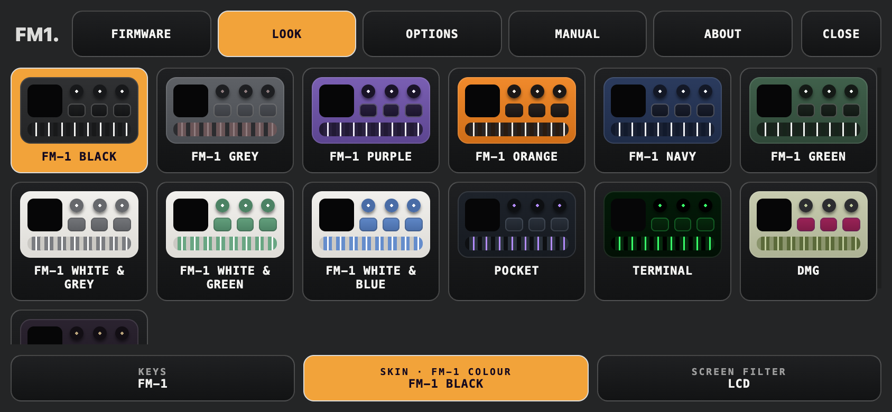

# FM1.Pocket

An M-VAVE FM-1 for the phone: a simpler front for [fm1-emu](https://github.com/joakimeriksson/fm1-emu) by
**Joakim Eriksson** (MIT), made to be installed as an app and played offline.

**Open it: https://utopick.github.io/fm1-pocket/pocket/**

| | |
|---|---|
|  |  |
|  |  |

The firmware on the screen in these pictures is GR!MM, by its own author.

This repository is a fork of fm1-emu. Everything outside this `pocket/` folder is Joakim's project, untouched.
The emulated FM-1 inside the page (CPU, flash, screen, keys, knobs, audio) is his core and his audio worklet,
unchanged. What this folder adds is one page around them: a phone-first front, a mapper for MIDI controllers and
installation as an app.

## What it does

- **Sideways on a phone, always.** One button goes round three views: the whole FM-1, the keys (with the
  knobs, screen and buttons shrunk above them), only the upper part (knobs, screen, buttons), each full screen. A phone held upright shows the same view turned.
  A narrow window on a computer gets an upright layout (screen, knobs, buttons, keys in two rows).
- **Keys** as the FM-1's own or as a piano. **Skins**: the nine colours the FM-1 is sold in (black follows a photo of the
  real one), then four of ours. **Screen filter**: LCD, CRT or clean.
- **Firmwares** from fm1-emu's list (the page reads `firmwares.json` from Joakim's site when online, so new
  ones appear by themselves; the Firmware Hub's `catalog.json` adds the ones fm1-emu's list lacks; the list built into the page is only the offline fallback, refreshed by `python3 pocket/update-firmwares.py`, which merges both and rebuilds). The
  FIRMWARE tab is a vertical list of banners, the ones you have first. A banner has one button, DOWNLOAD until the
  package is kept on the device (then it runs with no connection) and a lit USE after; MANUAL (the page looks through the firmware's repository for a manual or a guide and falls back to the README, saying which it shows); and ERASE, which
  asks whether to erase only what the firmware saved or the downloaded firmware too. A banner also carries the Firmware Hub's chip tag (NEWER CHIP ✓ saves on the newer flash chip 0xB36014, ANY CHIP does not check it, FIRST FM-1s ONLY keeps saves in RAM on a newer unit), and SEARCH has a SAVES ON NEWER FM-1s filter. A banner shows the date the
  author's host published the package, read when it is downloaded (the list itself has no dates). On the right,
  big: SEARCH, OPEN FILE (your own `.fwsc`), LOAD BANK (a DX7 bank of 32 voices, `.syx`, into the running firmware)
  and CLEAR (the downloads); the storage bar is in the bottom bar.
- **Saves.** What a firmware writes to its flash is kept per exact firmware version.
- **Slow devices.** When the device cannot keep up and the sound breaks up, the app offers to restart the firmware
  at a lower clock (80 or 60 MHz).
- **MIDI**: keys play the FM-1 through its MIDI IN. Knobs and pads work the FM-1's own knobs and buttons, with a
  starting assignment for known controllers (Akai MPK mini, Launchkey) and a drawing of the controller to assign
  and learn each control (the Pocket apps' device panel). **LIGHTS**: on a controller that takes lights (Launchkey MK4 37, so far), each pad shows the LED of the FM-1 button it works (amber, PLAY green, REC red; dim and bright), sent as notes to the controller's own output.
- A manual in English and Spanish in its own tab (this app, and how the FM-1 works with its stock firmware, after M-VAVE's user manual), the licences, computer keys, multi-touch. In the FM-1 part of the manual a small FM-1 sits beside the text: the controls the paragraph is about light up as you read (a ring for the others it mentions), the names in the text are little buttons and knobs you can tap to see where they are, and tapping a control on the small FM-1 jumps to its entry (`pocket/tests/manual.py`).
- **Installable (PWA)**: its own window, full screen, and it works offline. The menu wears the chosen skin.

## A real FM-1 on USB (OPTIONS, REAL FM-1) — written, not yet tried on a unit

Chrome or Edge (computer, or Android with a cable; no iOS), Web MIDI with SysEx. The protocol is in `vendor/real-fm1.js`, written from the
specification of [m-bootloader](https://github.com/jvitkauskas/m-bootloader) (MIT, by jvitkauskas), whose v2.4 packages
(`vendor/mboot/`, checked by SHA-256 before use, licence in `LICENSE-m-bootloader`) are what the page sends.

1. **CONNECT** finds the unit's ports (`FM-1 MIDI 1` while its firmware runs, `FM-1 Update` in m-bootloader's MIDI mode).
2. **SYNC**: what you play goes to the real unit too; its notes, bend, clock and start/stop come to the emulator. (The emulator has no MIDI out.)
3. **BACKUP** (step 1): sends m-bootloader's RAM helper through the firmware's own update route, then reads the whole flash (512-byte reads, each checked, then the chip's CRC-32) and saves a `.bin`. Only reads are ever sent to the helper. The copy is also wrapped as a one-file package, kept as the first entry of the firmware list (MY FM-1) and started in the emulator at once: if its screen draws, the copy is a good one. DELETE of the downloads leaves it.
4. **PROTECTOR** (step 2, only after a backup): sends the bootloader package. It writes the boot area.
5. **INSTALL FIRMWARE** (step 3, only in the protector's MIDI mode): serves the chosen firmware's package; the unit checks it before it erases. **No protector, no custom firmware**: every BACKUP is checked for m-bootloader's identity in the boot area (`AC79BLID` at payload offset 0x40 of the container at 0xA0), and step 3 stays locked until a backup of the same unit shows it. PROTECTOR is not sent on the newer flash chip (JEDEC B36014): use M-Flasher there, then BACKUP again. Every backup is also kept in this browser (IndexedDB, `unit:<id>`: the first one of a unit stays as its original, the last replaces the one before), so the checks are not repeated and files do not pile up: the file is saved for the first backup of a unit and on demand (SAVE BACKUP). The install starts with the "start install" soft message (`F0 22 24 35 7F F7`; the protector's MIDI mode waits for it), serves the package as the unit asks (it reads it twice and ends with a finish read) and, before sending anything, asks the questions the unit asks (a flash image of whole sectors, the block at 0x4000 readable with this unit's chip key, the image's CRC16), so a refusal is explained on the page and not only on the unit's screen. Each firmware card gets an INSTALL button only while the unit is in the protector's MIDI mode and a backup of it (this session's or the kept one) shows the same protector version. A flash map (the directory records and which 4 KiB sectors hold data) is drawn after each backup and written in the INSPECT · COPY report. The protector check has only been tried on synthetic flashes. The map is a 16 x 16 square coloured as in [M-Flasher](https://github.com/jvitkauskas/m-flasher) (MIT; its region colours and the stock FM-1 layout: boot 0x0000, firmware 0x4000, settings 0x93000, pairings 0xE9000, sounds 0xEA000, MAC 0xFF000). It uses that stock layout, not the unit's own file table, so a custom firmware that keeps its data elsewhere is coloured by where the stock one would.

If a unit stops starting, it can usually be brought back through the chip's own boot mode (the computer sees a USB disk `WL82 UBOOT1.00`) with [MvaveFM1Unbricker](https://github.com/Quixotic7/MvaveFM1Unbricker); the WARNINGS dialog says how and links it. Writes ask for a slide to confirm. Restoring a backup is not done here (use M-Flasher). Tests: `node --test pocket/tests/real-fm1.test.js` (a simulated unit and the real packages) and `python pocket/tests/real.py` (the page against a fake unit).

## Tether: the real FM-1 as the emulator's panel (written, not yet tried on a unit)

`pocket/firmware/` (GPL-3.0, built on [Dinghy](https://github.com/zvenson/dinghy)) is a firmware that sends every key, button, encoder
and the MASTER knob as MIDI and draws what the page sends to its screen and LEDs; the protocol is `firmware/PROTOCOL.md`, the page side
`vendor/tether.js`. `firmware/autobuild.sh` builds it from nothing (fetches JieLi's toolchain and three SDK files, needs Docker on a Mac) and puts `vendor/tether.fwsc` in place; `build.py` inlines it, so the page carries it. To try it: with the unit in the protector's MIDI mode (and a backup with the protector in it), CONNECT and press **PLAY WITH THE REAL FM-1**, which then says INSTALL TETHER ON THIS FM-1 and runs the same checks as any install; switch the unit on normally, CONNECT, and press the button again: if the
unit answers HELLO the button turns into TETHER · THE REAL PANEL · ON, the unit plays the emulator, and the emulator's screen and lights
appear on the unit. Tests: `node --test pocket/tests/tether.test.js`, and `pocket/tests/real.py` (a fake Tether unit).

## Roadmap

- MIDI sync with the real unit's clock into the emulated firmware's tempo (the emulator has no clock input yet) and the emulator's own notes out.
- Restore a backup from the page.

## Build and test

```sh
python3 pocket/build.py                                   # writes pocket/index.html from pocket/src/app.html and pocket/vendor/
python pocket/tests/smoke.py path/to/firmware.fwsc        # needs selenium and Chrome
```

Edit `pocket/src/app.html`. `pocket/vendor/midi-device.js` is the MIDI device panel
shared with the Pocket apps (copied from TUNE.Pocket's `<script id="midi-device">`, keep it identical).
`pocket/vendor/` also holds fm1-emu's built core (`fm1_web.wasm`), `worklet.js` and
`firmwares.json`, copied from its published page at commit 3e3fb27. To update them, build `web/` as the main
README says and copy the three files.

## Credits and licences

- fm1-emu: © Joakim Eriksson, MIT (`LICENSE` at the root, a copy in `pocket/vendor/LICENSE-fm1-emu`).
- The page in this folder: MIT, by utopick.
- Each firmware belongs to its author and keeps its own licence. None is in this repository. They come from
  [the FM-1 Firmware Hub](https://thefirmwarehub.com/).
- The skin colours named after the FM-1 are approximations by eye. Black follows a product photo, grey follows
  fm1-emu's drawing.
- Menu icons (FIRMWARE, LOOK, OPTIONS, MANUAL, ABOUT) from [Open Game Icons](https://open-game-icons.net/), CC BY 3.0
  (https://creativecommons.org/licenses/by/3.0/): Circuitry and Book cover by Lorc, Palette, Settings knobs and Info by
  Delapouite. Recoloured to follow the theme.
- Not affiliated with M-VAVE.
