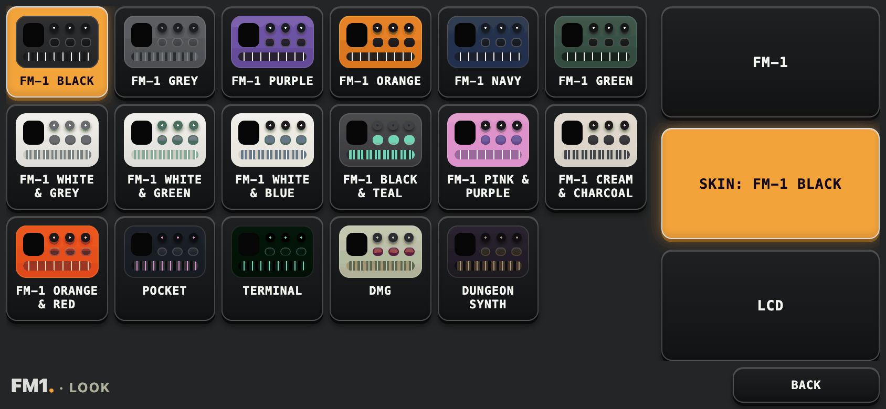

# FM1.Pocket

FM1.Pocket lets you play the M-VAVE FM-1 synthesizer on your phone or computer. It's free, needs no account, and
keeps working without internet once you've installed it.

**Open it: https://utopick.github.io/fm1-pocket/pocket/**


## What it is

The FM-1 is a small synth, and a community of people write their own programs for it, called firmwares. FM1.Pocket
runs a copy of the FM-1 in your browser, so you can try all of those firmwares without owning one. It is built on the
FM-1 emulator by Joakim Eriksson ([fm1-emu](https://github.com/joakimeriksson/fm1-emu)).

## What you can do

Hold your phone sideways and play it like the real thing: tap the keys and buttons, and drag a knob up or down to
turn it. You can use several fingers at once. One button switches between the whole FM-1, bigger keys, or just the
top part with the knobs and screen.

 

In LOOK you can swap the FM-1's keys for piano keys, pick any of the colours the FM-1 is sold in (or a few of ours),
and choose how the screen looks.



FIRMWARE lists the community's firmwares. Once you download one, it works offline, and each one comes with its
author's manual. You can also open a firmware file you already have, or load a bank of DX7 sounds.


If you have a MIDI keyboard, plug it in and its keys will play the FM-1, while its knobs and pads work the FM-1's
knobs and buttons. In OPTIONS, DEVICE shows a drawing of your keyboard, and MAP helps you set it up step by step.

MANUAL explains both this app and the FM-1 itself. The button at the top left of the menu switches the whole app
between English and Spanish. You can also install FM1.Pocket as an app from OPTIONS, so it gets its own icon and
opens full screen.


If your phone can't keep up and the sound stutters, the app will offer to run the firmware a little slower.

## Using a real FM-1

If you own an FM-1, you can connect it with a USB cable and put a firmware on it from OPTIONS, under REAL FM-1. This
needs Chrome or Edge on a computer, or an Android phone; it doesn't work on iPhone or iPad. There are four steps, shown along the top of the screen:


1. **CONNECT** the FM-1.
2. **BACKUP** saves a copy of everything on your FM-1 to a file, without changing anything. Keep that file somewhere safe.
3. **PROTECTOR** installs [m-bootloader](https://github.com/jvitkauskas/m-bootloader) by jvitkauskas, a safety net that
   means a firmware that goes wrong can always be replaced. It asks you before it writes anything.
4. **INSTALL** puts the firmware you choose on the FM-1. It stays locked until you've done steps 2 and 3.

If your FM-1 ever stops starting up, WARNINGS (under MORE) explains how to bring it back.

## Tether, our own firmware

Tether is a firmware we wrote for the real FM-1. It's free and open source, and it does two jobs.

The first is to connect your real FM-1 to FM1.Pocket. With the app open, the FM-1's keys, knobs and buttons play the
app, and the app sends its screen and lights back to the FM-1. That means you can try any firmware from the list on
real keys and a real screen without installing it on the unit, and the sound can come out of the FM-1's own output
too.

The second job starts when the app isn't open. Then the FM-1 becomes an ordinary USB MIDI keyboard that you can use
with any music app or program, on a computer or an Android phone. This is what it sends:

| On the FM-1 | What it sends |
|---|---|
| The 27 keys | Notes on channel 1. OCT- and OCT+ move them up or down an octave. |
| The other 12 buttons (FX to REC) | Pads: notes 36 to 47 on channel 10. |
| MASTER | CC 7 on channel 1. |
| SELECT, ALGORITHM, PRESETS and KNOB1 to KNOB4 | CC 74, 75 and 76, then 70 to 73, on channel 1. |

While you play, the FM-1's screen shows the control you just touched and its value, the tempo and bar when a program
sends MIDI clock, the chord you're holding, and a level meter for the sound coming in over USB. A program can also
light the FM-1's keys and pads the way it would light a Launchkey's pads, by sending notes back to it: a high velocity
gives a bright light and a low one a dim light.

The other Pocket apps know the FM-1 when it runs Tether. Their MIDI drawing shows its layout, its knobs and pads get
useful jobs straight away (in TRACK.Pocket the MASTER knob is the master volume, for example), and, if you allow it,
the FM-1's screen shows what each knob and pad does in that app.


The [Tether manual](firmware/MANUAL.md), in English and Spanish, explains all of this step by step.

To install Tether, open OPTIONS, then REAL FM-1, and press **PLAY WITH THE REAL FM-1**. It takes the same safe steps
as any other firmware, with a backup and the protector first. If you want M-VAVE's original firmware back, download
FM-1.fwsc from M-VAVE, open it with OPEN FIRMWARE FILE and install it the same way.

Tether works on Mac and Android, both as a controller and as a sound output. The screen and lights described above
are new in version 0.9. It is built on [Dinghy](https://github.com/zvenson/dinghy) by zvenson, which comes from
[Felucca](https://github.com/hugelton/Felucca) by Leo Kuroshita and [SLOOP](https://github.com/isod89/sloop-fm1) by
isod89, and like them it is GPL-3.0. Its code and the full list of who made what are in [`firmware/`](firmware/README.md),
and the messages it understands are described in [`firmware/PROTOCOL.md`](firmware/PROTOCOL.md).

## Credits and licences

- The emulator: fm1-emu, © Joakim Eriksson, MIT (`LICENSE` at the root, a copy in `vendor/LICENSE-fm1-emu`).
  Everything outside this `pocket/` folder is his project, unchanged.
- This app: MIT, by utopick.
- m-bootloader and M-Flasher: jvitkauskas, MIT (`vendor/mboot/LICENSE-m-bootloader`).
- Tether (`firmware/`): GPL-3.0, built on [Dinghy](https://github.com/zvenson/dinghy).
- Every other firmware belongs to its author, under its own licence. None is in this repository.
  They come from [the FM-1 Firmware Hub](https://thefirmwarehub.com/).
- The FM-1 colours are matched by eye.
- Menu icons: [Open Game Icons](https://open-game-icons.net/), CC BY 3.0, by Lorc and Delapouite.
- Not affiliated with M-VAVE.

## For developers

```sh
python3 pocket/build.py                              # builds pocket/index.html from src/app.html and vendor/
python pocket/tests/smoke.py path/to/firmware.fwsc   # needs selenium and Chrome
python pocket/tests/real.py                          # the REAL FM-1 pane, against a fake unit
python pocket/tests/manual.py                        # the manual, and the app in Spanish
node --test pocket/tests/real-fm1.test.js pocket/tests/tether.test.js
```

- Edit `src/app.html`, never `index.html`.
- `vendor/midi-device.js` is shared with the other Pocket apps: keep it identical.
- `python3 pocket/update-firmwares.py` refreshes the built-in firmware list (used when offline).
- `firmware/autobuild.sh` builds Tether into `vendor/tether.fwsc` (needs Docker on a Mac). Its protocol is in `firmware/PROTOCOL.md`.
